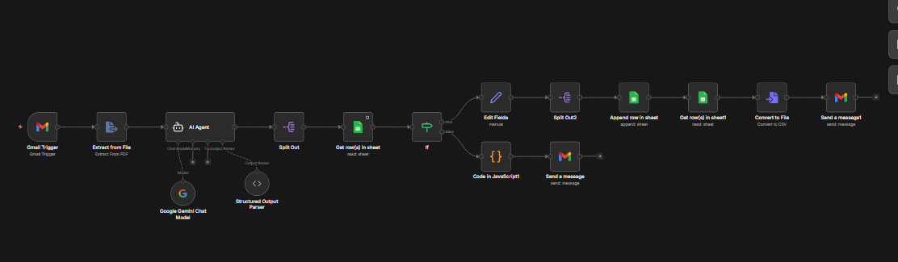
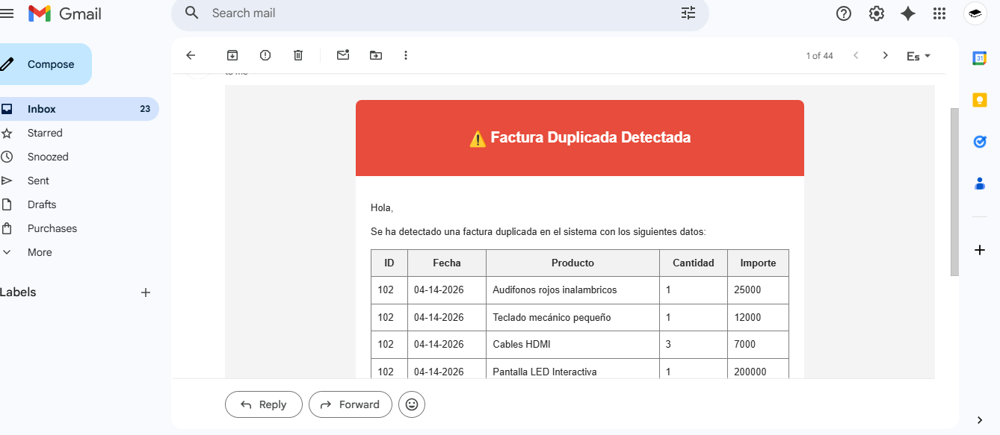
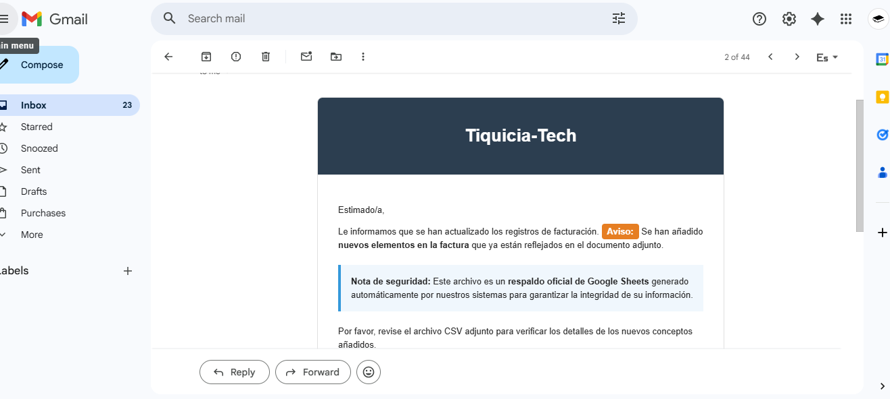

# Automatizacion de contabilidad con n8n

Automatización inteligente para la detección, clasificación y registro de facturas recibidas por Gmail, con validación de duplicados y alertas en tiempo real.

---

##  Vista General del Flujo



[Ver video de demostración](https://drive.google.com/file/d/1ObJ9rj-kRMP_sjfg6apm8qqpkIn2kyJ4/view?usp=sharing)

---

## Descripción

El sistema monitorea continuamente la bandeja de Gmail en busca de correos con facturas, los procesa con inteligencia artificial y los registra de forma estructurada en Google Sheets, evitando duplicados automáticamente.

---

## Etapas del Flujo

### Detección de Facturas vía Gmail

El nodo **Gmail Trigger** monitorea la bandeja de entrada y filtra correos que contengan la palabra `factura` en el asunto o cuerpo del mensaje.


### Lectura y Extracción del Contenido

El nodo **Gmail** obtiene el cuerpo completo del correo

---

### Procesamiento con Gemini AI

El contenido es formateado y clasificado por Gemini segun la categoría del producto utilizando el nodo de Agent AI.

**Ejemplo de respuesta estructurada:**

```json
  {
    "ID": "103",
    "Fecha": "20-07-2024",
    "Producto": "Laptop",
    "Categoria": "Tecnologia",
    "Importe": 300000,
    "Cantidad": 1,
    "Correo": "ejemplo@gmail.com"
  }
```

---

### Validación de Duplicados en Google Sheets

El nodo **Google Sheets** busca el `ID` en la hoja de registros antes de insertar.

Si la factura **no existe**, se agrega una nueva fila con todos los campos extraídos por Gemini más la fecha de registro.

---

### Factura Duplicada — Alerta por Gmail

Si la factura **ya fue registrada**, el nodo **Gmail** envía una alerta inmediata al usuario.



---

### Correo de Respaldo

Por cada factura registrada exitosamente, el sistema envía un correo de confirmación y un csv de respaldo de google sheets.




---

## Estructura del Repositorio

```
📂 n8n-contabilidad/
├──  README.md
├──  flujo.json
└── 📂 assets/
    ├── flujo.png
    ├──  alerta.png
    └──  respaldo.png
```
